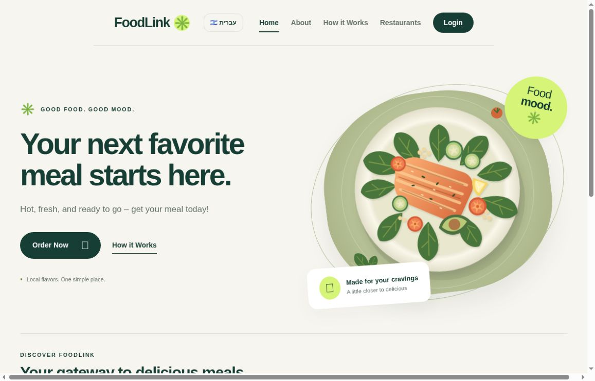
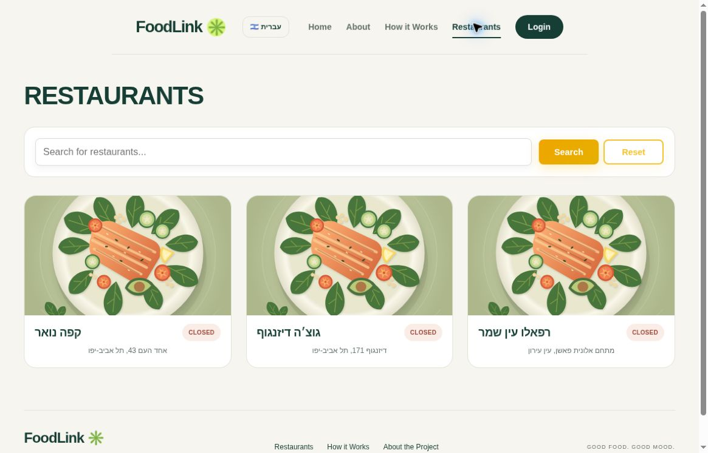
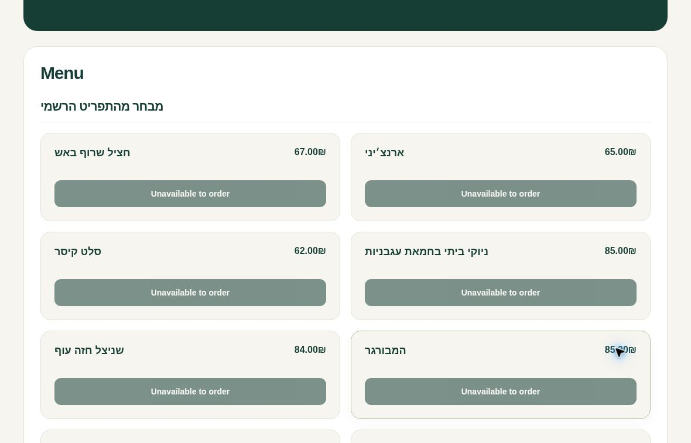

# FoodLink

**Restaurant discovery, food ordering, and a dedicated management workspace.**

A full-stack project that connects a React customer experience with three Python APIs for users, restaurant menus, and orders. A separate React workspace supports restaurant and order management.

[**Explore the live catalog**](https://foodlink-front.onrender.com/restaurants) · [Customer website](https://foodlink-front.onrender.com) · [Management sign-in](https://manager-front.onrender.com) · [Run locally](#run-locally-and-test)

**Demo scope:** The public site supports restaurant discovery and reference-menu browsing. Its listed restaurants are not connected to FoodLink ordering, so their order buttons are intentionally disabled. Use the local Firebase emulator fixtures below to explore the customer-to-manager order flow. Render's free APIs may take about a minute to wake up.

## See the experience

### 1. Start with the customer website

A clear entry point into restaurant discovery, with English and Hebrew navigation.



### 2. Find a restaurant

Browse restaurant cards or search by name, then open a restaurant to inspect its menu.



### 3. Explore the menu

Menu categories and item prices are visible before signing in. This public catalog is for reference, with ordering explicitly unavailable.



*Actual screenshots of the public website, captured November 6, 2026. [Capture details](docs/screenshots/README.md).*

## What the project implements

- **Customer experience:** restaurant search, menu browsing, Firebase email/password authentication, saved delivery addresses, cart editing, checkout state, order history, and live order-status updates.
- **Management workspace:** restaurant details, menus and opening hours, order views and delivery updates, plus administrator user-management screens.
- **Access control:** verified Firebase identities, custom-claim roles, and server-side ownership checks for customer, restaurant-owner, and administrator actions.
- **Localization:** English/LTR and Hebrew/RTL in the customer interface.

The ordering workflow is implemented in the application and can be exercised with local demo data. Checkout changes an order's state; it is not a payment-provider transaction. `CashWave/` and `PingNotify/` are placeholders, not implemented payment or notification services.

## Architecture

Two React applications call three separately deployed APIs. Both clients authenticate through Firebase Authentication; the APIs verify ID tokens and access Cloud Firestore through the shared `foodlink_core` layer. Browser Firestore access is denied by the checked-in rules.

| Component | Technology | Responsibility |
| --- | --- | --- |
| [Customer app](frontend) | React 19, React Router, i18next | Discovery, cart, profile, and order tracking |
| [Management app](manager-front) | React 19, React Router | Restaurant, menu, user, and order management |
| [UserBase](UserBase/users/firebase_views.py) | Django REST Framework | Profiles and administrator user operations |
| [DishBoard](DishBoard/restaurant/firebase_views.py) | Django REST Framework | Restaurants, opening hours, and menus |
| [OrderLine](OrderLine/firebase_routes.py) | FastAPI, WebSockets | Orders, item mutations, and live status updates |
| [Shared core](foodlink_core) | Firebase Admin SDK | Identity verification, Firestore access, and numeric-ID allocation |

The active runtime uses Firebase-only entrypoints. Legacy Django SQL models and SQLAlchemy code remain for reference and regression tests; they are not loaded by the Firebase runtime.

### Engineering focus: reliable orders and live updates

**Keeping prices and totals consistent.** The [order store](OrderLine/firebase_store.py) reads prices from the server's menu data, rejects items from a different restaurant, and stores money as integer cents. Firestore transactions update an order item and its total together, and commit order state with its history. Clients cannot set their own authoritative prices or totals.

**Keeping live updates scoped to the right customer.** The [WebSocket endpoint](OrderLine/firebase_routes.py) verifies an authentication frame and order access before subscribing. The [client](frontend/src/services/OrderLine/status/websocket.jsx) reconnects with bounded backoff and refreshes authoritative order data after reconnecting. Tokens are not placed in WebSocket URLs.

**Known scaling boundary:** WebSocket subscriptions are process-local, so OrderLine runs one worker. Multiple workers would need a shared message broker. Numeric ID counters also serialize allocation and are intended for the current modest workload.

## Run locally and test

Use the **local Firebase emulators** for a repeatable demonstration with disposable customer/admin accounts and a sample menu. Start with the setup below, then follow this flow:

1. Sign in to the customer app with the emulator customer account and open **Demo Kitchen**.
2. Add **Demo Dish** to the cart, adjust its quantity, and submit the order.
3. Sign in to the management app with the emulator administrator account and mark the order delivered.
4. Keep the customer's order-detail page open to see the status update.

No production demo credentials are published. The manager's live workspace requires an authorized account.

- [Firebase setup, authorization, and test commands](docs/firebase.md)
- [API contracts](docs/contracts.md)
- [Render deployment and service-specific build filters](docs/render.md)
- [Public restaurant catalog and source policy](docs/verified-restaurants.md)
- [Historical refactoring verification](docs/verification.md)

<details>
<summary><strong>Development setup and service commands</strong> (existing operating instructions)</summary>

Render hosting and per-service automatic build filters: [deployment guide](docs/render.md).

FoodLink now uses **Cloud Firestore and Firebase Authentication**. The selected
Firebase project is `foodlink-razmaz`, with a Standard Native Firestore database
in Tel Aviv (`me-west1`). No old data migration is required.

The three APIs remain separate, share the `foodlink_core` Firebase layer, and use
Firebase-only entrypoints that do not load Django SQL models or SQLAlchemy.
The customer and management interfaces authenticate using the Firebase Web SDK.

## הפעלה וכיבוי בפקודה אחת

מהתיקייה הראשית של הפרויקט:

```sh
./foodlink start          # הפעלת כל חמשת השירותים ברקע
./foodlink stop           # כיבוי כל השירותים שבניהול הפקודה
./foodlink restart        # הפעלה מחדש
./foodlink status         # מצב השירותים והכתובות
./foodlink logs           # הצגת הלוגים האחרונים
```

אפשר לנהל שירות אחד בלבד:

```sh
./foodlink start frontend
./foodlink stop manager
./foodlink restart dishboard
```

שמות השירותים: `frontend` (אתר הלקוחות, פורט 3000), `manager` (ניהול,
3002), `userbase` (משתמשים, 8001), `dishboard` (מסעדות ותפריטים, 8002),
`orderline` (הזמנות, 8003). הפעלת שירות בודד אינה מפעילה אוטומטית את שאר
השירותים; אתר הלקוחות זקוק לשרתי ה־API כדי לתפקד במלואו.

הפקודות נשארות זהות לאחר שינויי קוד. שרתי הפיתוח טוענים מחדש שינויי קוד
נתמכים; לאחר שינוי הגדרות סביבה השתמשו ב־`restart`. לאחר הוספת תלויות
יש להתקין אותן לפני ההפעלה מחדש. התהליכים ממשיכים לרוץ גם לאחר סגירת
הטרמינל, והמצב והלוגים נשמרים בתיקייה המקומית `.local-services/`.
הכיבוי פועל רק על תהליכים שהפקודה מנהלת. אם הפורט תפוס על ידי תהליך אחר,
תוצג שגיאה בלי לכבות אותו.

המצב הרגיל משתמש ב־Firebase האמיתי של הפרויקט ובקובצי `.env.local`
הקיימים. נדרשים חיבור אינטרנט והרשאות Application Default Credentials.
ההתקנה הראשונית והפעלה ידנית/אמולטורים מתוארות בהמשך.

## Run locally

Create each service's `venv` with Python 3.12 and install its
`requirements.firebase.txt`. Install Java 21+ and the official Firebase CLI for
the emulator workflow. From the repository root:

```sh
python3 scripts/run_firebase.py --emulators
# Separate terminal, demo-only fixture accounts/menu:
PYTHONPATH=. FIREBASE_PROJECT_ID=demo-foodlink \
FIREBASE_AUTH_EMULATOR_HOST=127.0.0.1:9099 FIRESTORE_EMULATOR_HOST=127.0.0.1:8080 \
UserBase/venv/bin/python scripts/seed_emulator.py
```

Inside `frontend` and `manager-front`, run `npm ci`, then:

```sh
# Customer
REACT_APP_USE_FIREBASE_EMULATORS=true REACT_APP_FIREBASE_PROJECT_ID=demo-foodlink npm start
# Manager (run in manager-front instead)
PORT=3002 REACT_APP_USE_FIREBASE_EMULATORS=true REACT_APP_FIREBASE_PROJECT_ID=demo-foodlink npm start
```

Demo accounts are **only in the emulator**: `admin@example.test` and
`customer@example.test`, password `FoodLink-test-123`. No default production
administrator or production test data is created.

For the real Firebase project, use existing Application Default Credentials
(`gcloud auth application-default login` if needed), run
`python3 scripts/run_firebase.py`, and start the UIs with their ignored
`.env.local` Firebase configuration. Do not set emulator variables in cloud mode.

See [Firebase setup, security and tests](docs/firebase.md).
Legacy SQL entrypoints/models remain for reference and their existing regression
suite; they are not used by the Firebase runtime or root Compose configuration.

</details>
